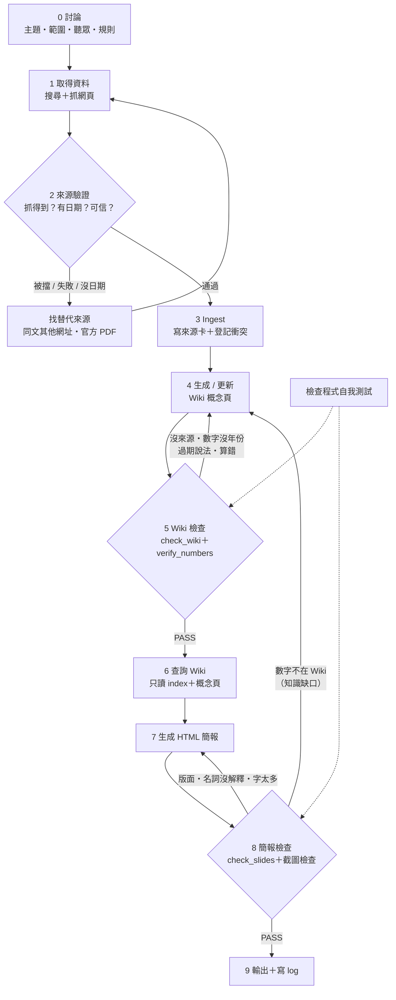

# 02 Loop / Graph 設計

## 一句話版本
**討論 → 取得資料 → 來源驗證 → Ingest → 生成 Wiki → Wiki 檢查 → 查詢 Wiki → 生成簡報 → 簡報檢查 → 輸出**
其中有 3 個檢查節點（下圖菱形），沒通過就退回前面的節點重做。

## 流程圖（第 2 版：實際執行後修改過）



> 在 GitHub 上打開這個檔案，上面的流程圖會自動畫出來；圖片版：[workflow-graph.png](workflow-graph.png)

## 每個節點做什麼

| # | 節點 | 輸入 → 輸出 | 用到的工具／檔案 |
|---|---|---|---|
| 0 | 討論 | 想法 → 範圍、聽眾、規則 | [01-discussion.md](01-discussion.md)、[AGENTS.md](../AGENTS.md) |
| 1 | 取得資料 | 主題 → 網頁內容 | 搜尋、抓網頁 |
| 2 | **來源驗證** | 網頁 → 可用／不可用 | 看有沒有抓到、有沒有日期、是不是官方或有引用官方 |
| 3 | Ingest | 網頁 → 來源卡 `wiki/sources/Sxx.md` | 改寫重點；寫日期、狀態；登記衝突到 `tools/rules.json` |
| 4 | 生成 Wiki | 來源卡 → 概念頁 `wiki/concepts/*.md` | 每句附 [Sxx] |
| 5 | **Wiki 檢查** | 概念頁 → PASS／錯誤清單 | `tools/check_wiki.py`、`tools/verify_numbers.py` |
| 6 | 查詢 Wiki | index + 概念頁 → 簡報大綱 | 只讀 Wiki，不回頭讀原始網頁 |
| 7 | 生成簡報 | 大綱 → `slides/index.html` | 每張標 `data-wiki` 和來源 |
| 8 | **簡報檢查** | 簡報 → PASS／錯誤清單 | `tools/check_slides.py`、`tools/screenshot_slides.py` |
| 9 | 輸出 | 通過的 Wiki + 簡報 | 寫進 `wiki/log.md` |

## 三個檢查節點各檢查什麼

| 節點 | 檢查項目 | 為什麼 |
|---|---|---|
| 2 來源驗證 | 抓得到嗎？有日期嗎？官方或有引用官方說法嗎？跟其他來源衝突嗎？ | 證交所部分頁面會擋抓取；ETF 規定會改；新聞會誤讀規定 |
| 5 Wiki 檢查 | W1 來源卡欄位、W2 段落、W3 每句有來源、W4 數字有年份或標明假設、W5 沒有投資建議語氣、W6 沒有已知過期說法；另外用程式重算 19 個數字 | 錯誤越早抓越便宜；Wiki 是後面所有輸出的基礎 |
| 8 簡報檢查 | D1 有對應 Wiki 頁、D2 有來源、D3 數字在 Wiki 裡找得到、D4 語氣、D5 名詞第一次出現要解釋、D6 每張 ≤ 180 字、D7 結尾有免責聲明；V1–V4 版面（超出、壓到來源列、console 錯誤、控制列蓋住） | 確保簡報沒有「Wiki 以外的知識」，而且新手看得懂 |

## 哪些步驟會重複執行？

1. **取得資料 ↔ 找替代來源**：抓不到就換網址再抓，直到來源夠（本次 15 次抓取、3 次失敗）。
2. **生成 Wiki ↔ Wiki 檢查**：檢查沒過就改概念頁，再檢查一次。
3. **生成簡報 ↔ 簡報檢查**：版面或用語問題，只改簡報。
4. **簡報檢查 → 生成 Wiki**：簡報出現 Wiki 裡沒有的數字，代表知識有缺口，要回到 Wiki 補（補完要重跑 Wiki 檢查），不可以只在簡報上硬改。
5. **整條流程**：之後每 ingest 一篇新來源，就從節點 3 往下重跑一次。

## 哪些地方需要檢查或重新生成？

- **日期和數字**：ETF 檔數、規模、費用率每年都變；舊文章的說法可能已經過期（例：主動式 ETF）。
- **規定類內容**：要以主管機關說法為準（例：2025 年配息指引不是「新規」）。
- **自己算的例子**：複利、配息率、再平衡金額，一律用程式重算。
- **語氣**：ETF 很容易寫成「推薦哪一檔」，要擋掉。
- **簡報版面**：字太多、超出畫面、名詞沒解釋，新手就看不懂。

## 為什麼這樣設計？

1. **錯誤越早抓越便宜。** 來源錯了，後面 Wiki 和簡報全部跟著錯；所以第一個檢查放在來源，不是放在簡報。
2. **Wiki 是唯一的知識來源。** 簡報只能從 Wiki 拿內容（D3 規則）。這樣簡報一出錯，就知道是 Wiki 缺東西還是簡報寫錯。
3. **能用程式檢查的，就不要靠 LLM 自己說「我檢查過了」。** 數字重算、來源標記、日期、版面都寫成程式，每次跑的結果都存在 `checks/`。
4. **檢查程式也會錯。** 所以檢查程式要先做自我測試（故意寫錯，看它抓不抓得到）。

## 第 1 版 → 第 2 版改了什麼

第 1 版是討論階段一開始提出的流程：

```
取得資料 → 建 Wiki → 查詢 Wiki → 整理重點 → 事實檢查 → 語氣檢查 → 產生簡報 → 新手可讀性檢查
（不通過 → 回到整理重點）
```

實際跑完一次後改成上面的第 2 版：

| 改了什麼 | 原因（執行時遇到的問題）|
|---|---|
| 在「取得資料」後面加「來源驗證」節點和「找替代來源」迴圈 | 15 次抓取有 3 次失敗（2 個證交所頁面被擋）；沒有這一步，LLM 可能會用記憶補內容 |
| 事實檢查、數字檢查從簡報之前，往前移到 Wiki（節點 5）；日期與衝突登記再往前移到 Ingest（節點 3）| 問題都出在來源（過期、衝突、新聞誤讀），越早擋越好 |
| 新增「簡報檢查 → 生成 Wiki」這條回頭的線 | 簡報第 1 輪出現 Wiki 沒有的數字（42%、-21%），正確修法是補 Wiki，不是改簡報 |
| 新增「檢查程式自我測試」 | 截圖檢查程式本身有漏洞，第 3 輪把 17 張有問題的投影片誤判成 OK |

詳細過程見 [03-run-record.md](03-run-record.md)，反思見 [04-reflection.md](04-reflection.md)。
